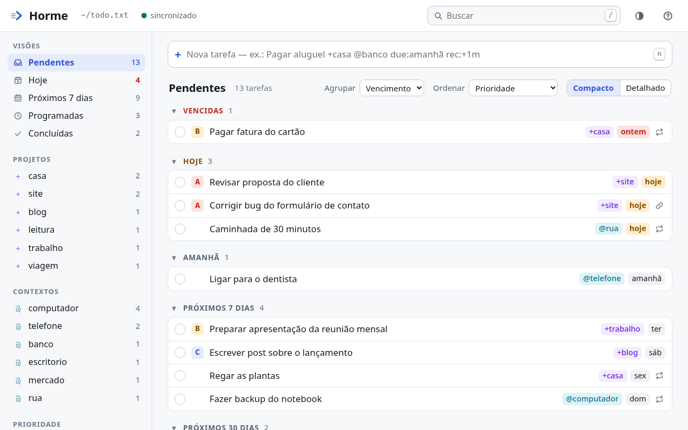
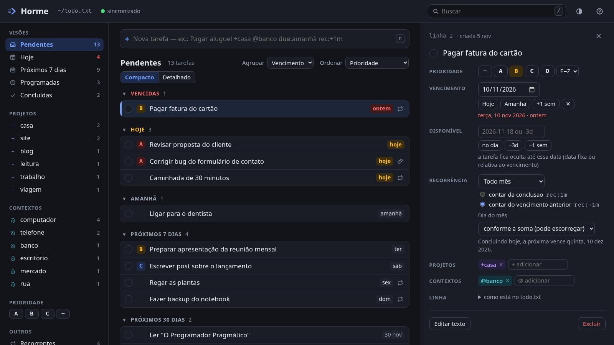

<h1 align="center">
  <picture>
    <source media="(prefers-color-scheme: dark)" srcset="docs/logo-dark.svg">
    
  </picture>
</h1>

<p align="center"><strong>English</strong> · <a href="README.pt-BR.md">Português</a></p>

**Hormé** (Ὁρμή) is a minor deity in Greek mythology who personifies the impulse to act: initiative,
effort, and the energy that sets something in motion. She has no myths of her own; she is a personified
force, whose counterpart is Aergia, sloth. Pausanias records an altar dedicated to her in the agora of
Athens (*Description of Greece*, I.17), and for the Stoics *hormē* is the impulse that leads from
judgment to action.

Hence the name: a task written down is an intention, and Horme exists to turn it into action.

A personal task manager built on `todo.txt`, opened in the browser and served only on `localhost`.
The file is the single source of truth: there is no database, cache, or custom format.





```sh
./horme --open            # opens http://localhost:8788/
./horme ~/other/todo.txt  # explicit file
```

Requires only Python 3.10+ (standard library). The interface is plain HTML/CSS/JS, with no build step
and no CDN. The interface itself is in Brazilian Portuguese.

## Which file it opens

Same order as Tuxedo (and todo.txt-cli):

1. `FILE` argument
2. `$TODO_FILE`
3. `$TODO_DIR/todo.txt`
4. Horme's config (`~/.config/horme/config.json`, written by the page itself)
5. `./todo.txt` in the directory Horme was started from
6. otherwise, the page asks for the path

The archive file is `$DONE_FILE`, or the `done.txt` next to `todo.txt`.

## Format

Follows the [official specification](https://github.com/todotxt/todo.txt) and the conventional extensions,
with Tuxedo's semantics:

| Token | Meaning |
| --- | --- |
| `(A)` | priority, at the start of the line |
| `x 2026-11-11` | completed, with completion date |
| `+project` `@context` | anywhere in the line |
| `due:2026-11-20` | due date |
| `t:2026-11-18` / `t:-3d` | threshold: hidden from the list until that date; relative values are anchored on `due:` (or on the creation date) |
| `rec:1w` | repeats 1 week after **completion** |
| `rec:+1w` | repeats 1 week after the **previous due date** |
| `pri:A` | priority kept on a completed task (as the spec suggests) |
| `day:31` | with monthly/yearly `rec:`: always on day 31, or the last day of the month (Horme extension) |
| `key:value` | any other metadata: preserved untouched |

Units for `rec:` and `t:`: `d` days, `b` business days, `w` weeks, `m` months (end of month is clamped:
Jan 31 + 1m = Feb 28), `y` years (`rec:` only).

### Recurrence

When a task with `rec:` is completed, Horme generates the next line **byte for byte identical to Tuxedo**
(`tests/test_tuxedo_compat.py` compares against the installed binary):

- `rec:+N` starts from the previous `due:` (or from today, if there is none); `rec:N` starts from today;
- the new line keeps the priority, gets today's creation date and the new `due:`; everything else stays
  the same, so a `t:-3d` follows the due date;
- if an open occurrence of the same series already exists, no new one is created.

### End of month: `day:N`

Adding months loses the day: Jan 31 + 1m = Feb 28, and from then on Mar 28, Apr 28… (Tuxedo, sleek, topydo
and friends all behave the same way; the spec does not define recurrence). With `day:N`, the monthly or yearly
occurrence lands on day N, or on the last day of the month when the month is shorter:

```
(A) Send monthly report due:2026-11-30 t:-3d rec:+1m day:31           → Dec 31, Jan 31, Feb 28, Mar 31…
Pay condo fee due:2028-01-30 rec:+1m day:30                           → Feb 29, Mar 30, Apr 30…
```

Tuxedo ignores `day:` but preserves it; if the task is completed there, the date slips once and the next
completion in Horme puts it back on the right day. In the side panel, the option is under
Recurrence → Day of month (*Recorrência → Dia do mês*).

### Other deliberate differences from Tuxedo

Both produce spec-valid lines that Tuxedo reads normally:

- **Priority on completion:** Tuxedo discards it; Horme moves it to `pri:A` (as the spec suggests) and
  restores `(A)` when the task is reopened.
- **Creation date on completion:** Tuxedo makes up today's date when the task has none; Horme does not
  make up data.

## File integrity

- Every operation rereads the file, locates the line by the text the interface saw (the position is only
  a hint), and changes **only that line**. Blank lines, order, LF/CRLF, BOM, a missing trailing newline,
  and non-UTF-8 bytes stay as they were.
- If the line was changed outside Horme, the operation is rejected (`409`) and the list is refreshed,
  instead of overwriting the change.
- Atomic writes (temporary file in the same directory, `fsync`, `rename`), following symlinks and keeping
  permissions. Right before the `rename` the file is reread; if another program wrote to it in the
  meantime, the operation is redone on the new content.
- Before every write, the previous version goes to `~/.local/state/horme/backups/` (the last 60).
  Turn this off with `--no-backup`.
- Undo (`u`) works even after external changes to other lines; if the line itself changed, Horme warns
  you instead of undoing.

## Agents and other programs

Any program can edit `todo.txt` directly (including the `tuxedo` CLI). Horme checks the file every 250 ms
and updates the page on its own via Server-Sent Events, highlighting new or changed lines. There is nothing
to import or reload.

## Interface

- **Views:** Pending (*Pendentes*), Today (*Hoje*, includes overdue), Next 7 days (*Próximos 7 dias*),
  Scheduled (*Programadas*, `t:` in the future), Completed (*Concluídas*, with archiving to `done.txt` and
  reading from it).
- **Combinable filters** in the sidebar: projects, contexts, priority, recurring, plus search (`/`).
  Within a group they combine with "or"; across groups, with "and".
- **Group** by due date, priority, project, or context; **sort** by priority, due date, creation date,
  description, or file order.
- **Compact** rows (one line, truncated text) or **detailed** rows (up to 3 lines plus extra metadata),
  toggled with `v`. Clicking a task opens the side panel with the full text and every field editable.
- When adding, `due:tomorrow`, `due:fri`, `due:+3d`, `t:today` become ISO dates (Portuguese words such as
  `due:amanhã` and `due:sex` work too; the preview shows exactly what will be written). With a single
  project/context filtered, the new task gets that tag automatically.
- `?` shows all keyboard shortcuts.
- Size: `--zoom` at the top of `web/app.css` (default `1.2`, equivalent to 120% browser zoom).

## Run it always

`~/.config/systemd/user/horme.service`:

```ini
[Unit]
Description=Horme (todo.txt)

[Service]
ExecStart=/path/to/horme/horme
# Environment=TODO_FILE=%h/todo.txt
Restart=on-failure

[Install]
WantedBy=default.target
```

```sh
systemctl --user enable --now horme
```

On Hyprland, an "app" window without browser bars:

```
bind = SUPER, T, exec, chromium --app=http://localhost:8788/
```

## Development

```sh
python3 -m unittest discover -s tests -t .
```

| File | Role |
| --- | --- |
| `todotxt.py` | parser, dates, recurrence, surgical line edits |
| `storage.py` | in-memory document, atomic writes, file watcher |
| `server.py` | HTTP, API, SSE, path resolution |
| `web/` | interface |
